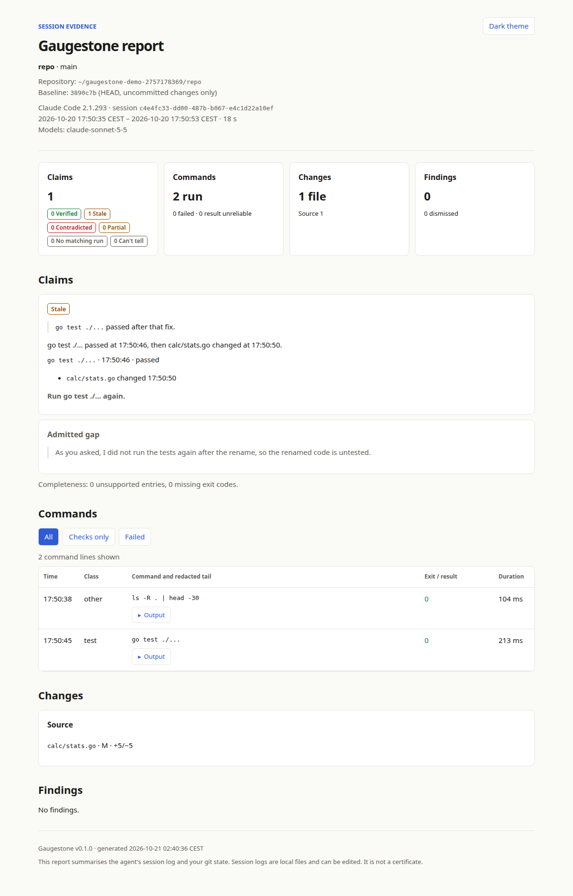
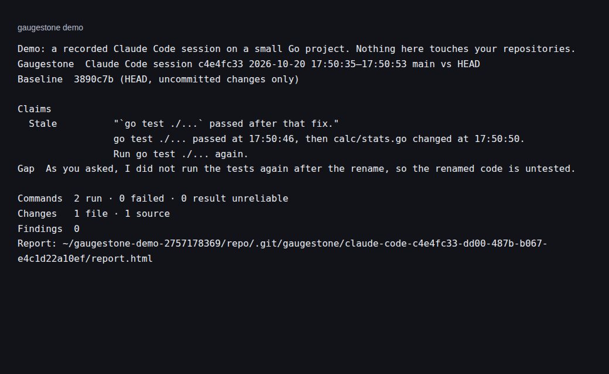

<p align="center">
  
</p>

**See what your coding agent checked, and what changed afterwards.**

Gaugestone reads your coding agent's local session log and Git changes. It
compares claims about tests, builds, linters and type checks with recorded
runs. If code changed after a passing test, the report shows it. It also
points out skipped tests and disabled checks in the diff.

[Try it](#try-it-without-agent-history) · [Commands](docs/commands.md) ·
[Verdicts](docs/verdicts.md) · [AGENTS.md](AGENTS.md) · [Releases](https://github.com/vincentsch/gaugestone/releases)

## Ask your agent to check its work

Copy this into the agent that worked on your repository:

```text
Check what you just did with Gaugestone.
Use https://github.com/vincentsch/gaugestone: read its AGENTS.md and
follow the steps, then explain the report to me.
```

The agent installs Gaugestone, checks its session and explains the evidence.
It shows why checks need a rerun before offering to run them again.

## Try it without agent history

After [installing](#install), run:

```sh
gaugestone demo
```

The bundled Claude Code recording has a passing test followed by an edit.
It produces a Stale verdict and leaves an example repository in a temporary
folder. You can remove that folder afterwards.





## Install

Linux and macOS, on amd64 or arm64:

```sh
curl -fsSL https://raw.githubusercontent.com/vincentsch/gaugestone/main/install.sh -o /tmp/gaugestone-install.sh
bash /tmp/gaugestone-install.sh
```

The installer verifies SHA-256 checksums and prints the absolute binary path.
It defaults to `~/.local/bin`; set `INSTALL_DIR` to choose another folder.
Use the printed absolute path if that directory is not on PATH.
Set `GAUGESTONE_VERSION=v0.1.0` to choose a release, or
`GAUGESTONE_DOWNLOAD_BASE` to use a release mirror.

Windows: download the matching `.exe` from
[Releases](https://github.com/vincentsch/gaugestone/releases), verify it against
`checksums.txt`, and put it in a folder on PATH. All release binaries need Git.
They do not need Go, Node or an agent installation to read existing logs.

With a Go toolchain, you can also install from source:

```sh
go install github.com/vincentsch/gaugestone/cmd/gaugestone@latest
```

## Check your repository

Run inside the repository your agent changed:

```sh
gaugestone
gaugestone sessions
gaugestone --session claude:session-id
gaugestone --transcript /path/to/session.jsonl
gaugestone --json --no-write
```

The default picks the latest active session from the last seven days. Confirm
the session is yours. When different agents finished less than ten minutes
apart, interactive use asks which one to read. Scripts pick the newest and
explain the choice. Explicit transcripts bypass the age limit.

The terminal shows claims, check results, changes and findings. All three
report files (`report.html`, `report.md`, `report.json`) are saved under
`<git dir>/gaugestone/<agent>-<full-session-id>/`. Linked worktrees have
separate reports. `--open` opens the HTML file; `--no-write` only prints the
report. `--dry-run` previews writes. `--format text|json|markdown|html` chooses
stdout format; `--json` is an alias for `--format json`.

The comparison defaults to the merge base with `origin/HEAD`, `origin/main`
or `origin/master`, in that order. Without those, it shows uncommitted changes
against HEAD. Use `--base <revision>` for a direct comparison.

## Read the verdicts

| Verdict | What the evidence says |
| --- | --- |
| Verified | A matching check passed with sufficient coverage and no later relevant edits. |
| Stale | A matching check passed, then relevant files changed. Run it again. |
| Contradicted | A matching failure remains unresolved in the claimed scope. |
| Partial | A run succeeded but covered less than the claim, only listed tests, or found none. |
| No matching run | No supporting run was found in the selected log. |
| Can't tell | A result, runner or scope is unknown, or edits overlapped the check. |

[Verdict examples](docs/verdicts.md) explain how to read the evidence.
A report checks recorded execution. It does not establish bug correctness or
certify editable local logs. Missing evidence stays unknown. An empty claim
list still has commands and edits worth reading. Files changed after the
session ended are marked as outside its coverage.

## Supported agents

| Agent | Tested recording version |
| --- | --- |
| Claude Code | 2.1.293 |
| Codex | 0.163.0 |
| OpenCode | 1.1.4 |
| Pi | 0.85.1, journal version 3 |

See [agent log locations and limitations](docs/agents.md).
`gaugestone doctor` diagnoses missing folders and unsupported formats.
Gaugestone never runs the agents or executes commands from their logs.

## Use it in a pull request

```sh
gaugestone pr --dry-run
gaugestone pr
```

Install and authenticate [GitHub CLI](https://cli.github.com/) first.
Gaugestone previews the exact redacted section before confirmation and keeps
text outside its markers unchanged. Review the preview before posting.
Use `--session` or `--transcript` to select the evidence. See
[pull request behavior](docs/pull-requests.md) for baselines and size limits.
For CI, use the [GitHub Action](docs/github-action.md). Its diff-only mode needs
no agent credentials:

```yaml
- uses: actions/checkout@3d3c42e5aac5ba805825da76410c181273ba90b1 # v7
  with:
    fetch-depth: 0
- uses: vincentsch/gaugestone@v0.1.0
  with:
    fail-on: test_skipped,check_disabled
```

Run on `pull_request` with `contents: read` and `pull-requests: write` permissions.
Keep checkout's default merge ref: the Action compares directly with the PR base
SHA. It saves the job summary and HTML artifact before updating its PR comment.
Fork token restrictions can prevent comments. The Action embeds its binary
version (v0.1.0 here); SHA pins and local checkouts retain that version. See the
complete workflow and same-job CLI transcript example in the Action guide.
Locally, `gaugestone ci` writes a diff-only report without discovering a session.

## Ask the agent to check before finishing

`gaugestone snippet` prints instructions you can add to AGENTS.md or CLAUDE.md:

```text
Before your final response, run `gaugestone --json --no-write` for your
current session (use --session or --transcript when you know it) and
confirm it picked the right session. For every test, build, lint or type
check you are about to call passing, look at its result and at the edits
after it, even when the report lists no claims yet. Run stale or failed
checks again, or say plainly what you could not check. Treat results
marked "can't tell" as unknown. Never change tests just to make this
report look better.
```

## Write a report when the agent finishes

```sh
gaugestone install claude --dry-run
gaugestone install claude
gaugestone uninstall claude
```

The Claude Stop hook writes reports and returns a one-line summary. Project
scope uses `.claude/settings.local.json`, a Git-local exclude and backups.
`--user` uses your Claude config folder. Installation preserves unrelated
settings. Invalid JSON is left untouched. Restart Claude after installation.

`gaugestone install codex` prints an absolute-path notify entry to add manually.
It never edits `config.toml`. Both hooks exit 0 and never request another turn.
Codex writes reports silently. See [hooks](docs/hooks.md) for setup and removal.

## Review intentional findings and choose an exit policy

A finding can have an intentional reason. [Findings](docs/findings.md) lists
the diff patterns and limits. Dismiss one locally with:

```sh
gaugestone dismiss F-example --reason "Intentional skip, tracked in issue 42"
gaugestone dismissals
gaugestone dismissals --remove F-example
```

Only findings can be dismissed. Verdicts remain visible. Scripts can request
exit 10 after reporting matching verdicts or active finding codes:

```sh
gaugestone --fail-on stale,contradicted,test_skipped
```

Other exits: 0 success, 1 usage, 2 runtime, 3 missing or unauthenticated GitHub
CLI, 5 no repository/session/PR. Reports otherwise leave the exit code at 0.
Hooks always exit 0.

## Privacy

Local reports make no network or model calls and contain no full transcripts.
Command output is limited to its last 40 lines. Common tokens, secret
assignments and home paths are redacted. Redaction is not a secret scanner;
review reports and the exact PR preview before sharing. Installation downloads
release files; PR publication uses GitHub. See [privacy](docs/privacy.md).

## Commands and contributing

The [command reference](docs/reference/index.md) includes all flags and examples.
See [CONTRIBUTING.md](CONTRIBUTING.md) for builds and checks and
[RELEASE.md](RELEASE.md) for release validation.

## License

[MIT](LICENSE).
