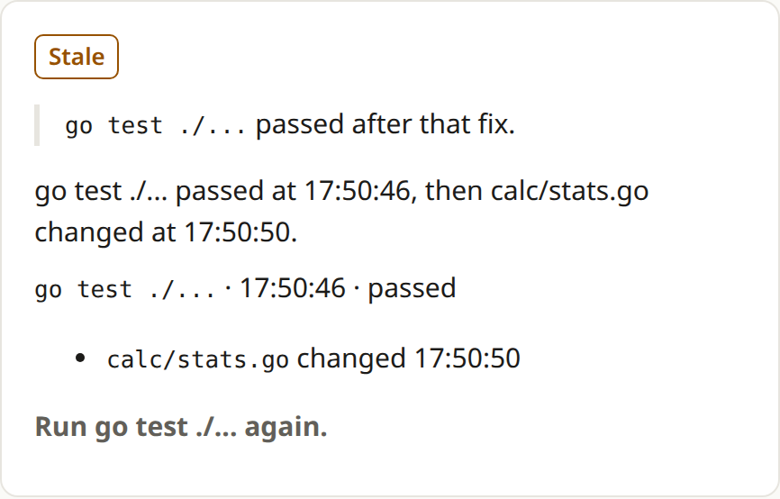

<p align="center">
  <picture>
    <source media="(prefers-color-scheme: dark)" srcset="docs/media/wordmark-dark.svg">
    
  </picture>
</p>

Saidran is a free, open-source CLI for developers who use coding agents like
Claude Code or Codex. It reads the agent's session log and your Git changes.
When the agent says the tests pass, Saidran shows whether a recorded test run
backs that up, or whether the code changed after that run. It checks claims
about builds, linters and type checks the same way, and it flags skipped tests
and disabled checks in the diff.

[Website](https://www.saidran.com) · [Quickstart](docs/quickstart.md) · [FAQ](docs/faq.md) ·
[Commands](docs/commands.md) · [AGENTS.md](AGENTS.md) ·
[Releases](https://github.com/vincentsch/saidran/releases)

## Ask your agent to check its work

Paste this into the agent that worked on your repository:

```text
Check what you just did with Saidran.
Use https://github.com/vincentsch/saidran: read its AGENTS.md and
follow the steps, then explain the report to me.
```

The agent installs Saidran, runs it on its own session and explains the report
to you. It tells you which checks need a rerun before it offers to run them.

## Install and try the demo

On Linux and macOS, amd64 or arm64:

```sh
curl -fsSL https://raw.githubusercontent.com/vincentsch/saidran/main/install.sh -o /tmp/saidran-install.sh
bash /tmp/saidran-install.sh
```

The installer verifies the SHA-256 checksum and prints the absolute path of the
binary. If that folder is not on your PATH, run the commands below with the
printed path. The release binaries need Git. The [quickstart](docs/quickstart.md#install)
covers Windows, `go install` and the installer's environment variables.

```sh
saidran demo
```

The demo checks a recorded Claude Code session that ships with the binary. In
that session a test passed, then the agent edited the code and did not run the
test again, so the claim gets the Stale verdict. The example repository is
unpacked into a temporary folder. Delete it when you are done.

[](docs/media/demo-html.png)

[Full HTML report](docs/media/demo-html.png) · [Terminal output](docs/media/demo-terminal.png)

## Check your repository

Run Saidran in the Git repository your agent worked on. The repository needs at
least one commit:

```sh
saidran
```

Saidran picks the newest session for this repository from the last seven days.
Check that the summary names the session you meant. It lists each recorded
check and the edits that came after it, and it saves an HTML report with
Markdown and JSON versions next to it. The terminal prints the path of the HTML
file. The [quickstart](docs/quickstart.md#check-your-repository) explains how
to pick another session, what to do when no log is found and how to open the
saved report.

## Read the verdicts

| Verdict | What the evidence says |
| --- | --- |
| Verified | A matching check covered the whole claim and passed, and no relevant file changed after it. |
| Stale | A matching check passed, then relevant files changed. Run it again. |
| Contradicted | A matching check failed, and no later passing run covers that failure. |
| Partial | A matching check passed but covered less than the claim says, for example one package instead of the whole suite. A run that only listed tests or found none is also Partial. |
| No matching run | No run in the selected log matches the claim. The log may be incomplete. |
| Can't tell | A matching run exists, but its result can't be read reliably, for example because the test output went through tail. |

A report cannot tell you that a bug is fixed, and it cannot prove that a local
log is genuine. Read the recorded commands and the later edits even when the
report lists no claims. Files that changed after the session ended are listed
separately. See the [verdict examples](docs/verdicts.md) and the [FAQ](docs/faq.md).

## Supported agents

Saidran reads the session logs of these agents:

- Claude Code
- Codex
- OpenCode
- Pi

The [agent guide](docs/agents.md) lists the tested versions and where each
agent keeps its logs. Saidran never runs the agents and never executes commands
from their logs.

## Use it with your agent or in CI

`saidran snippet` prints a short instruction for AGENTS.md or CLAUDE.md. With
it, the agent runs Saidran on its own session before it answers and reruns
stale or failed checks. The [hooks](docs/hooks.md) for Claude Code and Codex
write a report after each session. They never block the agent and never ask for
another turn.

`saidran pr` adds the report to the pull request of the current branch through
GitHub CLI and shows you the redacted section before it posts anything. The
[GitHub Action](docs/github-action.md) writes the report into the job summary,
uploads the HTML as an artifact and comments on the pull request. In diff-only
mode it needs no agent credentials. Like `check`, a local `saidran ci` needs a
repository with at least one commit.

[Findings](docs/findings.md) explains how Saidran reports skipped tests, deleted
test files and disabled checks. [Commands](docs/commands.md) covers the
comparison baseline, the exit codes and how to dismiss a finding with a reason.

## Privacy and contributing

Saidran makes the report on your machine, without network or model calls, and
a report never contains the full transcript. Common tokens, secret assignments
and home paths are redacted, but redaction is not a secret scanner. Read a
report before you share it. Installing downloads the release files, and
`saidran pr` talks to GitHub. The [privacy guide](docs/privacy.md) lists what a
report contains and where it is saved.

The [command reference](docs/reference/index.md) lists every flag with
examples. [CONTRIBUTING.md](CONTRIBUTING.md) explains how to build and test.
Saidran is available under the [MIT license](LICENSE).

Built with [rungrad](https://rungrad.com).
